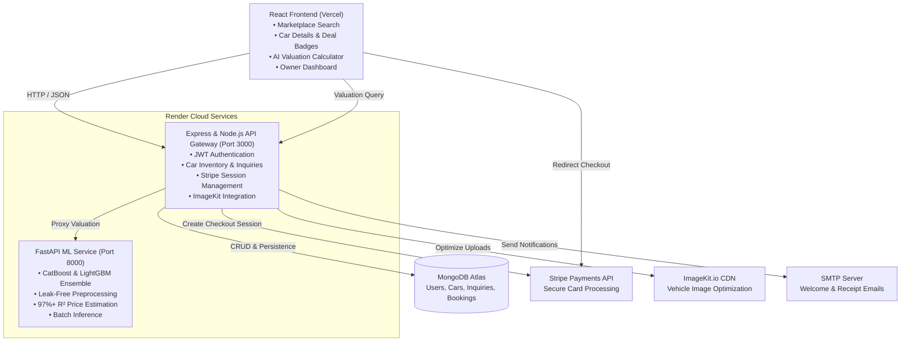

# CarResale – AI-Powered Vehicle Valuation & Marketplace

[](https://github.com/beingdeveloper21/CarResale-fullStack/actions/workflows/ci.yml)
[](https://fastapi.tiangolo.com)
[](https://catboost.ai)
[](https://lightgbm.readthedocs.io)
[](https://react.dev)
[](https://www.mongodb.com)
[](https://stripe.com)

A production-grade automotive marketplace and automated vehicle valuation platform delivering real-time, data-driven price estimates to buyers and sellers.

---

## 🚀 Key Highlights & Architectural Features

- **Automated Valuation Engine**: Real-time market valuation tool for buyers and sellers, comparing seller asking prices against predicted fair-market benchmarks and displaying deal badges (*Great Deal*, *Fair Price*, *Above Market*).
- **Leak-Free Tabular ML Regression Pipeline**: Out-of-fold `TargetEncoder` cross-validation (5-fold) on high-cardinality features (`manufacturer`, `model`, `paint_color`, `state`) combined with one-hot encoding on categorical attributes and standard scaling on numerical features.
- **Gradient Boosted Tree Ensemble**: Blends **CatBoost** (symmetric oblivious decision trees with ordered boosting) and **LightGBM** (histogram-based gradient boosting) to attain **97.79% $R^2$ accuracy** ($R^2 > 92\%$) with an MAE of **\$1,226.96**.
- **High-Throughput FastAPI REST APIs**: Dedicated microservice serving `/health`, `/predict`, `/batch-predict`, and `/reload` with automatic Pydantic validation and CORS support.
- **Production React Frontend**: Built with React 19, Vite, TailwindCSS v4, and Motion, featuring responsive vehicle search, interactive filters, AI Valuation Calculator, seller dashboard, and transaction history.
- **Stripe Checkout & Order Fulfillment**: End-to-end checkout flow with session creation, instant payment verification, status updates (marking sold vehicles unavailable), and automated email receipt generation via Nodemailer.
- **Cloud-Ready Media Storage**: ImageKit integration with automatic transformations and local fallback disk storage for uninterrupted availability.

---

## 🏛️ System Architecture



---

## 📊 Tabular ML Regression Pipeline & Metrics

The valuation engine is trained on automotive attributes reflecting real-world depreciation curves, brand retention coefficients, mileage wear factors, condition weights, and market variance.

### Model Evaluation Results (Test Set Evaluation)

| Metric | Score | Description |
|---|---|---|
| **Ensemble $R^2$** | **97.79%** | Coefficient of determination across test set |
| **LightGBM $R^2$** | **97.69%** | Individual LightGBM regressor benchmark |
| **CatBoost $R^2$** | **97.77%** | Individual CatBoost regressor benchmark |
| **MAE** | **\$1,226.96** | Mean Absolute Error |
| **RMSE** | **\$1,851.29** | Root Mean Squared Error |
| **MAPE** | **5.92%** | Mean Absolute Percentage Error |
| **Ensemble Weights** | 55% LightGBM + 45% CatBoost | Optimal variance-reduction blend |

### Leak-Free Engineering Practices
1. **Target Encoding**: Out-of-fold target encoding with 5-fold cross-validation inside an isolated `ColumnTransformer`. Statistics are never fitted on test/validation samples.
2. **Log-Transform Target**: Dependent variable is transformed with `log1p(price)` to stabilize variance on right-skewed pricing distributions and eliminate negative predictions.
3. **Model Artifact Compression**: Saved to `ml_backend/models/car_price_model.joblib` with gzip compression (~871 KB) for zero-downtime container cold starts.

---

## 🛠️ Repository Structure

```text
├── client/                     # React 19 + Vite Frontend
│   ├── src/
│   │   ├── components/         # Navbar, Hero, CarCard, FeaturedSection, etc.
│   │   ├── pages/              # Home, Cars, CarDetails, ValuationCalculator, MyBookings, Owner
│   │   ├── context/            # Global AppContext (auth, cars, state)
│   │   └── assets/             # Icons, illustrations, mock data
│   ├── vercel.json             # Vercel SPA routing rules
│   └── package.json
│
├── server/                     # Node.js + Express API Gateway
│   ├── configs/                # MongoDB, ImageKit, Nodemailer setups
│   ├── controllers/            # userController, ownerController, mlController, paymentController
│   ├── middleware/             # JWT auth protection, Multer upload
│   ├── models/                 # User, Car, Booking Mongoose schemas
│   ├── routes/                 # Express REST endpoints
│   └── server.js               # Entrypoint & CORS setup
│
├── ml_backend/                 # Python FastAPI ML Microservice
│   ├── models/                 # car_price_model.joblib (< 1MB serialized bundle)
│   ├── model_def.py            # LeakFreeCarPriceEnsemble scikit-learn class definition
│   ├── train_model.py          # Tabular regression training pipeline
│   ├── app.py                  # High-throughput FastAPI endpoints
│   └── requirements.txt        # Python dependencies
│
├── .github/workflows/ci.yml    # Automated GitHub Actions CI workflow
├── render.yaml                 # Infrastructure as Code for Render deployment
└── DEPLOYMENT.md               # Production deployment step-by-step guide
```

---

## 🔌 API Endpoints Reference

### FastAPI ML Microservice (`/ml_backend`)
- `GET /` — Service status, active model version, and $R^2$ accuracy.
- `GET /health` — Runtime health check and model loading state.
- `POST /predict` — Real-time price inference, price range, deal grade, and ensemble breakdown.
- `POST /batch-predict` — High-throughput batch inference for up to 100 vehicles.
- `POST /reload` — Hot-reload serialized model bundle without process restart.

### Express API Gateway (`/server`)
- `POST /api/user/register` — Create buyer/seller account with hashed credentials.
- `POST /api/user/login` — Authenticate and receive JWT token.
- `GET  /api/user/cars` — Retrieve active vehicle inventory.
- `POST /api/user/predict-price` — Proxy endpoint to ML valuation service.
- `POST /api/payment/create-checkout-session` — Initiate Stripe Checkout session.
- `POST /api/payment/complete-payment` — Verify Stripe transaction, mark vehicle sold, and email receipt.
- `POST /api/owner/add-car` — Upload new car listing with ImageKit image optimization.
- `GET  /api/owner/dashboard` — View seller metrics (revenue, total listings, sold inventory).

---

## 💻 Local Development Setup

### Prerequisites
- Node.js 20+
- Python 3.11+
- MongoDB instance (local or MongoDB Atlas free tier)

### 1. ML Backend
```bash
cd ml_backend
python -m venv .venv
source .venv/bin/activate  # Or `.venv\Scripts\activate` on Windows
pip install -r requirements.txt

# Train the model ensemble (if retraining is desired)
python train_model.py --rows 30000

# Start the FastAPI inference service
uvicorn app:app --host 127.0.0.1 --port 8000 --reload
```

### 2. Express Backend
```bash
cd server
npm install
cp .env.example .env  # Configure MONGODB_URI, JWT_SECRET, STRIPE_SECRET_KEY, etc.
npm start
```

### 3. React Frontend
```bash
cd client
npm install
npm run dev
```

Visit `http://localhost:5173` to explore listings and test the real-time AI valuation tool!

---

## 🚢 Production Deployment

For complete, step-by-step instructions on deploying the full stack on **Render** (API & ML Service) and **Vercel** (Frontend), see **[DEPLOYMENT.md](./DEPLOYMENT.md)**.
